<div align="center">

<picture>
  <source media="(prefers-reduced-motion: reduce)" srcset="assets/banner-static.svg">
  
</picture>

<br/>



<br/>

<a href="https://react.dev"></a>
<a href="https://www.typescriptlang.org"></a>
<a href="https://vite.dev"></a>
<a href="https://vitest.dev"></a>

<br/>



<br/>


<a href="https://lexeraapp.github.io/"></a>

<br/><br/>

*Three phases, six game types and a vowel harmony engine, in one dark, mobile-first app that needs no account.*

<br/>

[Overview](#overview) · [Features](#features) · [Curriculum](#curriculum) · [Game design](#game-design) · [Harmony engine](#harmony-engine) · [Progress](#progress-system) · [Architecture](#architecture) · [Design system](#design-system) · [Install](#install-as-an-app) · [Getting started](#getting-started) · [Deployment](#deployment) · [Contributing content](#adding-content)

</div>

---

<a id="overview"></a>
##  Overview

**Lexera** teaches Turkish to English speakers, from the first greeting to relative clauses. It is a static frontend: there is no backend, no sign up and no tracking, and your progress is stored on your own device.

Turkish is agglutinative. It builds meaning by attaching suffixes to a stem (`ev`, `evler`, `evlerde`), and every suffix changes its vowel to match the word it joins. Most courses teach this as a table to memorise. Lexera teaches it as a pattern: a suffix engine generates the correct ending for any stem and explains the rule, so you can drill the two harmony patterns thousands of times in different words until the right vowel simply feels right.

| | |
|---|---|
| **Course** | 3 phases (A1, A2, B1), 30 units, 60 lessons |
| **Content** | 480 words, 236 example sentences, 411 grammar drills, plus endless generated drills |
| **Games** | Choose, Listen, Match, Type, Build, Harmony drill |
| **Modes** | Lessons, spaced Review, Harmony gym, 60 second Speed round, phase test-out |
| **Platform** | Mobile-first PWA, offline after first load, no account |

> [!NOTE]
> Course content follows common CEFR A1 to B1 progression. Have a native speaker review anything you plan to rely on in formal settings.

---

<a id="features"></a>
##  Features

<table>
<tr>
<td width="50%" valign="top">

 **Learning path**
- 30 units on a winding path, 2 lessons each
- Grammar note for every unit, readable any time
- Lessons unlock after one star, with 3 stars for 90 percent
- Test out of a phase with a 10 question exam at 80 percent

</td>
<td width="50%" valign="top">

 **Adaptive difficulty**
- A director holds you near 82 percent correct
- Warm up, build, peak, cool down in every session
- Missed items return a few steps later in an easier form
- Older words are mixed into new lessons

</td>
</tr>
<tr>
<td width="50%" valign="top">

 **Harmony engine**
- 43 suffix families built from vowel and consonant harmony
- Every drill shows the rule behind the answer
- Covers plural, cases, to be, negation, present, past, future, aorist, ability, evidential, conditional, passive, reported speech and relative clauses

</td>
<td width="50%" valign="top">

 **Sound**
- Turkish text to speech at normal and slow speed
- A phonetic alphabet page with an anchor word per letter
- Synthesised sound effects, no audio files, with a mute toggle
- Listening exercises are skipped when no Turkish voice exists

</td>
</tr>
<tr>
<td width="50%" valign="top">

 **Rewards**
- XP, five craft level titles and 19 badges
- Streak freezes cover missed days, no lives
- Daily goal of 20, 40 or 60 XP
- Five week activity heat map

</td>
<td width="50%" valign="top">

 **Platform**
- Installable as a home screen app, works offline
- Safe-area aware, large touch targets
- Respects reduced motion, plus its own toggle
- Backup and restore through a copyable code

</td>
</tr>
</table>

---

<a id="curriculum"></a>
##  Curriculum


Each lesson teaches eight words in context, then practises them through varied formats, then mixes in words from earlier lessons. The full course is 60 lessons and a 480 word core. It covers the grammar of A1 to B1 and the vocabulary you meet most often; it is a strong foundation, not a complete B1 word list. The grammar note for a unit is always one tap away in the Atlas.

<details>
<summary><b>Every unit and its grammar</b></summary>

| Phase | Unit | Lessons | Grammar focus |
|---|---|---|---|
| Beginner | 1. Sounds and greetings | Hello and goodbye, Polite basics | Alphabet, stress, dotted and dotless i |
| Beginner | 2. I am, you are | Who are you, How are you feeling | `-(y)Im -sIn -(y)Iz`, four-way harmony |
| Beginner | 3. Things and numbers | Things around you, Numbers one to eight | `-lAr`, `-DA`, var and yok, two-way harmony |
| Beginner | 4. Everyday actions | What are you doing, Food and drink | `-(I)yor`, question particle `mI` |
| Beginner | 5. Colors and describing | Colors, Describing things | Adjectives, `değil`, bu, şu, o |
| Beginner | 6. Days and numbers | Days of the week, The clock and big numbers | Negative present `-mIyor`, time with `-DA` |
| Beginner | 7. At home | Rooms and furniture, Around the house | `-DA` with the to be endings |
| Beginner | 8. Food and restaurants | Meals and ingredients, At the restaurant | `-lI`, `-sIz`, hungry and full |
| Beginner | 9. Daily routine and school | My day, School and study | Infinitive `-mAk`, verbs of the day |
| Beginner | 10. Asking questions | Who, when, why, Understanding and answering | Question words, polite requests |
| Intermediate | 1. Yesterday and today | Time words, Verbs of the day | `-DI` with d and t |
| Intermediate | 2. Places and directions | Places in town, Finding your way | `-(y)A -DA -DAn -(y)I`, buffer y |
| Intermediate | 3. People and shopping | Family and friends, Shopping | Possession, genitive, having with var |
| Intermediate | 4. Plans and abilities | Travel plans, Needs and requests | `-(y)AcAk`, `-(y)Abil`, lazım and gerek |
| Intermediate | 5. Body and health | Parts of the body, At the pharmacy | Negative past `-mA-DI`, ağrımak, `-(I)n` |
| Intermediate | 6. Clothes and shopping | Clothing, Trying and buying | `-(s)I`, consonant softening, accusative |
| Intermediate | 7. Months and seasons | Seasons and the first months, The rest of the year | Dates and months with `-DA` |
| Intermediate | 8. Hobbies and invitations | Free time, Making plans together | `-(y)AlIm`, `-mAyI sevmek` |
| Intermediate | 9. Getting around town | Streets and stops, Directions and traffic | Genitive `-(n)In`, compounds, `ile` |
| Intermediate | 10. Habits and routines | How often, Chores and routines | Aorist `-Ar -Ir`, thirteen exceptions |
| Advanced | 1. Hearsay and opinion | Telling and learning, Opinions and reasons | `-mIş` evidentiality |
| Advanced | 2. If, weather and work | Weather and wishes, Work and career | `-sA`, `-sAydI`, keşke |
| Advanced | 3. Voice and linking | Things get done, Before, after, while | Passive, causative, `-ken`, `-DIktAn sonra` |
| Advanced | 4. Ideas and etiquette | Describing with clauses, Social formulae | `-(y)An`, `-DIK`, fixed expressions |
| Advanced | 5. Discussion and decisions | Debating, Problems and solutions | `-mAlI`, opinion verbs, participles |
| Advanced | 6. Culture and travel in Turkey | Places and heritage, Hospitality and recommendations | Light verbs `etmek` and `olmak` |
| Advanced | 7. Work, technology and reporting | Digital life, Projects and reports | Noun clauses, reported speech |
| Advanced | 8. Nature and the news | Nature, In the news | `-lI`, `-sIz`, participles |
| Advanced | 9. Telling stories | Connecting events, Memory and imagination | `-(I)yordu`, `-mIştI`, `-Ip`, habitual past |
| Advanced | 10. Formal language | Meeting and greeting formally, Appointments and official language | Register, `-(y)In`, `-(y)Abilir miyim` |

</details>

---

<a id="game-design"></a>
##  Game design

### Six game types


The **Match** game uses one CSS grid with two columns, so a Turkish card and its candidate meaning always share a row and face each other, whatever their text length.

### Session arc


Every session is planned as an arc. It opens with introduction cards and easy recognition, builds with mixed formats and interleaved review, climbs to production tasks such as typing and sentence building, and cools down on a word you already know. Exercises are built lazily, one at a time, at the difficulty the director has reached so far.

| Rule | What happens |
|---|---|
| Target | The director aims for about 82 percent correct, close to the roughly 85 percent optimum reported for learning |
| Mercy | Two misses in a row lower the tier immediately |
| Stretch | Five hits in a row raise it, so a strong player never gets bored |
| Retry | A missed item is queued again four steps later in an easier form, up to four times per session |
| Carry over | Your skill per phase is blended into the next session, so a new lesson starts at your level |

### Spaced retrieval


Only your **first attempt** in a session moves a word between boxes, so retries and lucky guesses cannot inflate your progress. Review ranks due words by how overdue they are and how often you have lapsed on them.

### Research behind it

| Idea | How Lexera uses it | Source |
|---|---|---|
| Spaced retrieval | Leitner boxes with expanding intervals | Ebbinghaus 1885, Cepeda et al. 2006, Roediger and Karpicke 2006 |
| The 85 percent rule | `DifficultyDirector` targets about 82 percent | Wilson et al. 2019 |
| Desirable difficulty | Production tasks at the peak of each session | Bjork 1994 |
| Interleaving | Due words from older lessons mixed into new ones | Rohrer and Taylor 2007 |
| Flow | No lives, mercy rule, adaptive tiers | Csikszentmihalyi 1990 |
| Peak-end rule | Sessions end on a strong item | Kahneman et al. 1993 |
| Comprehensible input | Sentences sit just beyond known words, always translated | Krashen 1982 |

The same explanations appear in the app under **Atlas, Method**.

---

<a id="harmony-engine"></a>
##  Harmony engine


`SuffixBook` holds 43 suffix families. Each one knows its allomorphs, how to build the correct form for any stem, and why. The same code produces the drill answer, the wrong options, and the explanation shown after you answer.

```ts
import { SuffixBook } from "./src/core/Harmony.ts";

SuffixBook.get("locative").build("kitap");
// { form: "kitapta", add: "ta", why: ["the last vowel of \"kitap\" is a (back, unrounded), so the suffix takes a.",
//                                   "Also, the stem ends in \"p\", a voiceless consonant, so d becomes t."] }

SuffixBook.get("part1").build("oku").form;     // "okuduğum"
SuffixBook.get("passpast").build("gönder").form; // "gönderildi"
```

Unit tests check the engine against known forms, and a content test builds every drill in the course, so a typo in a lesson cannot ship a wrong answer.

<details>
<summary><b>Suffix families</b></summary>

| Group | Families |
|---|---|
| Nouns | plural, locative, ablative, dative, accusative, genitive, possessive (my, your, his), with `-lI`, without `-sIz` |
| To be | I am, you are, we are |
| Present | continuous (I, you, we), negative continuous (I, you), aorist (I, you, he), let us |
| Past | I, you, he or she, negative past, past continuous, past perfect, habitual past |
| Future and ability | I will, you will, I can, you can, must |
| Verb forms | infinitive `-mAk`, gerund `-(y)Ip` |
| Advanced | evidential `-mIş`, conditional `-sA`, relative `-(y)An`, participles `-DIğIm` and `-DIğIn`, passive past |

</details>

---

<a id="progress-system"></a>
##  Progress system


| Icon | Badge | Tier | Earned by |
|---|---|---|---|
|  | First Light | 1 | Finishing your first lesson |
|  | Sound Check | 1 | Completing the sounds and greetings unit |
|  | Three Tides, Seven Tides, Thirty Tides | 1 to 3 | Streaks of 3, 7 and 30 days |
|  | First, Working and Wide Vocabulary | 1 to 3 | Knowing 25, 100 and 250 words |
|  | In Harmony, Perfect Pitch | 1, 2 | 25 and 100 correct grammar drills |
|  | Good Ear | 2 | 20 correct listening answers |
|  | Sentence Smith | 2 | 20 correctly built sentences |
|  | Clean Sheet, Ten Clean Sheets | 1, 3 | Flawless lessons |
|  | Quick Hands | 2 | 15 correct in a Speed round |
|  | Steady Hand | 2 | Reaching the daily goal on 7 days |
|  | Foundations, Crossing, Summit | 2, 3, 3 | Finishing each phase |

---

<a id="architecture"></a>
##  Architecture


All behaviour lives in framework-free TypeScript classes. React components read state through one `useSyncExternalStore` hook and forward taps, so the engine can be tested without a DOM.

| Layer | Classes | Responsibility |
|---|---|---|
| `src/core` | `Harmony`, `SuffixBook`, `TurkishText`, `Rng` | Language rules, locale-safe casing, seeded randomness |
| `src/content` | `ContentLibrary` and the lesson files | Parses the compact lesson format into typed objects |
| `src/engine` | `SessionPlanner`, `ExerciseFactory`, `PracticeSession`, `DifficultyDirector`, `ReviewScheduler`, `StreakKeeper`, `BadgeBook`, `Levels`, `XpRules`, six `Exercise` subclasses | Game rules, scoring, adaptation |
| `src/services` | `AppStore`, `Speech`, `SoundFx`, `Haptics`, `InstallHelper`, `SafeStorage` | Persistence, audio, platform APIs |
| `src/ui`, `src/screens` | React components | Rendering only |

<details>
<summary><b>Project structure</b></summary>

```
lexeraapp.github.io/
├─ .github/workflows/deploy.yml     test, build, publish to GitHub Pages
├─ assets/                          README artwork (generated)
│  ├─ badges/  icons/  *.svg
├─ public/
│  ├─ manifest.webmanifest          install metadata
│  ├─ sw.js                         offline service worker
│  ├─ icons/                        PWA icons, maskable icon, apple touch icon
│  └─ favicon.svg  404.html
├─ scripts/build-readme-assets.py   regenerates assets/ from the project fonts
├─ src/
│  ├─ core/        Harmony, TurkishText, Rng, types
│  ├─ content/     beginner.ts, intermediate.ts, advanced.ts, alphabet.ts, ContentLibrary
│  ├─ engine/      planner, factory, session, director, scheduler, rewards, exercises/
│  ├─ services/    AppStore, Speech, SoundFx, Install, Storage
│  ├─ ui/          Backdrop, Icon, Logo, Medal, Ring, Shell, context
│  ├─ screens/     Path, Practice, Atlas, You, Welcome, play/
│  └─ styles/      tokens, base, shell, screens, play
└─ vite.config.ts                   base "/"
```

</details>

---

<a id="design-system"></a>
##  Design system


Lexera inherits the *Abyssal Liturgy* system from [hassanireza.github.io](https://hassanireza.github.io): near-black surfaces, a single light source, hairline borders, Cormorant Garamond italics for display, Jost for interface copy and JetBrains Mono for small labels. Fonts are self-hosted through Fontsource, so the app looks the same offline.

| Token | Value | Use |
|---|---|---|
| `--bg` | `#08090b` | Page void |
| `--bg-2` | `#0d1013` | Sheets and cards |
| `--text` | `#e6e3da` | Primary text |
| `--text-2` | `#9aa3a8` | Secondary text |
| `--accent` | `#7c8891` | Interactive accent, shifts per phase |
| `--accent-bright` | `#c9cfd2` | Highlights, progress |
| `--ok` | `#9dbba9` | Correct answers |
| `--near` | `#cdbb8c` | Almost right |
| `--bad` | `#c88f86` | Wrong answers |
| `--ease-liturgy` | `cubic-bezier(.16,.4,.15,1)` | Signature easing |

Feedback colours are always paired with an icon or text, never used alone. The phase you are in tints the background light: cool steel for Beginner, blue-grey for Intermediate, warm bone for Advanced.

The mark is a **tulip** (lale), a long-standing emblem of Turkish culture, inside the portfolio's hairline halo.

---

<a id="install-as-an-app"></a>
##  Install as an app

| Platform | Steps |
|---|---|
| iPhone and iPad | Open in Safari, tap Share, then Add to Home Screen |
| Android | Open in Chrome, tap Install app in the menu or the prompt in the You tab |
| Desktop | Use the install icon in the address bar of Chrome or Edge |

Once installed, Lexera opens full screen and works offline after its first load. The service worker serves fingerprinted assets from cache, tries the network first for page loads so updates arrive, and falls back to the cached shell when you are offline.

> [!TIP]
> Your progress is stored in the browser on that device. Use **You, Back up your progress** to copy a code, and paste it into Lexera on another device to restore.

---

<a id="getting-started"></a>
##  Getting started

**Prerequisites:** Node.js 22 or later, and npm.

```bash
git clone https://github.com/lexeraapp/lexeraapp.github.io.git
cd lexeraapp.github.io
npm install
npm run dev
```

Open <http://localhost:5173/>.

```bash
npm test           # engine, content integrity and a full UI smoke test
npm run build      # type-check, then build into dist/
npm run preview    # serve the production build locally
```

The test suite (23 tests) covers the harmony engine against known forms, every drill in the course, scheduler promotion and demotion, difficulty control, streak freezes, level curve, accent-tolerant typing, the match layout, a simulated play of every lesson at two skill levels, and a DOM smoke test that boards the app and plays a lesson to its summary.

---

<a id="deployment"></a>
##  Deployment


`.github/workflows/deploy.yml` runs on every push to `main`: install with `npm ci`, run the tests, type-check and build, upload the Pages artifact and deploy. Pull requests run the tests and build without deploying.

1. Create the repository `lexeraapp.github.io` under the `lexeraapp` account. A repository named `<account>.github.io` is a user site served from the root, so the Vite base is `/`.
2. In **Settings, Pages**, set **Source** to **GitHub Actions**.
3. Push to `main`. The site appears at <https://lexeraapp.github.io/>.

Hash routing is used, so deep links work on GitHub Pages without redirects.

---

<a id="adding-content"></a>
##  Adding content

Lessons live in `src/content/beginner.ts`, `intermediate.ts` and `advanced.ts` in a compact format:

```ts
{
  title: "Things around you",
  goal: "Name common objects and say where they are.",
  tip: "Var and yok also express having: Arabam var means I have a car.",
  words:     ["kitap|book", "araba|car", "merhaba|hello|mer-HA-ba"],   // tr|en|pronunciation
  sentences: ["Masada kalem var.|There is a pen on the table."],       // tr|en
  drills:    ["plural|kitap|books", "locative|ev|in the house"],       // family|stem|gloss
}
```

Run `npm test`. The content test checks that every field is filled, that no em dashes or emoji slipped in, and that every drill builds against the harmony engine.

### Regenerating the README artwork

All SVGs in `assets/` are generated, with text converted to outlines from the project fonts so they render identically on GitHub.

```bash
pip install fonttools
npm install
python3 scripts/build-readme-assets.py
```

---

##  Accessibility

- Every control is a real button or input with a text label or `aria-label`; toggles use `role="switch"`.
- Correct and wrong answers are shown with an icon and text as well as colour.
- Motion is reduced automatically with `prefers-reduced-motion`, and a toggle in settings does the same.
- Touch targets are large, and layouts respect safe areas on notched phones.
- Typing exercises accept answers without accents as "almost", so a standard keyboard never blocks progress, and a Turkish letter row sits above the keyboard.

---

##  Ideas for later

These are possibilities, not commitments.

- More units toward B2
- Dictation exercises with slower speech and replay limits
- Optional cloud sync through an export file instead of accounts
- Dialogue lessons with branching replies

---

##  License

Released under the [MIT License](LICENSE). Fonts are the open source Cormorant Garamond, Jost and JetBrains Mono distributed through Fontsource.

<br/>

<div align="center">


</div>
